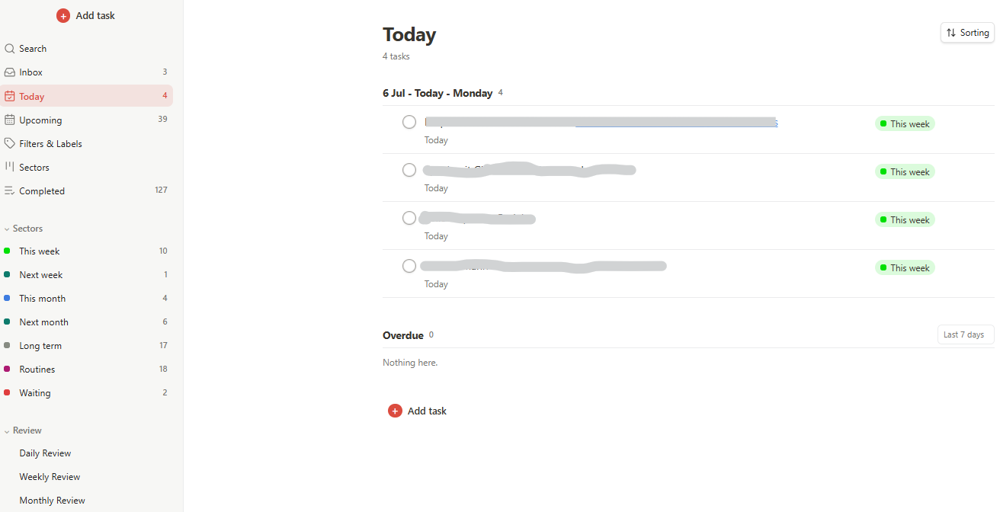
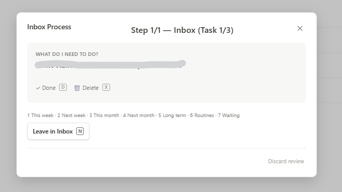
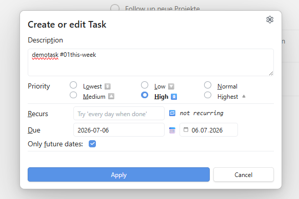
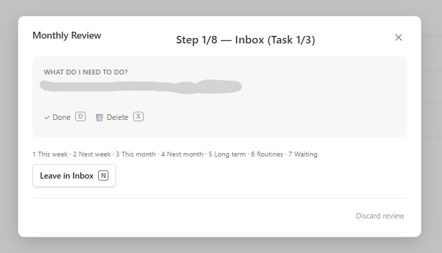
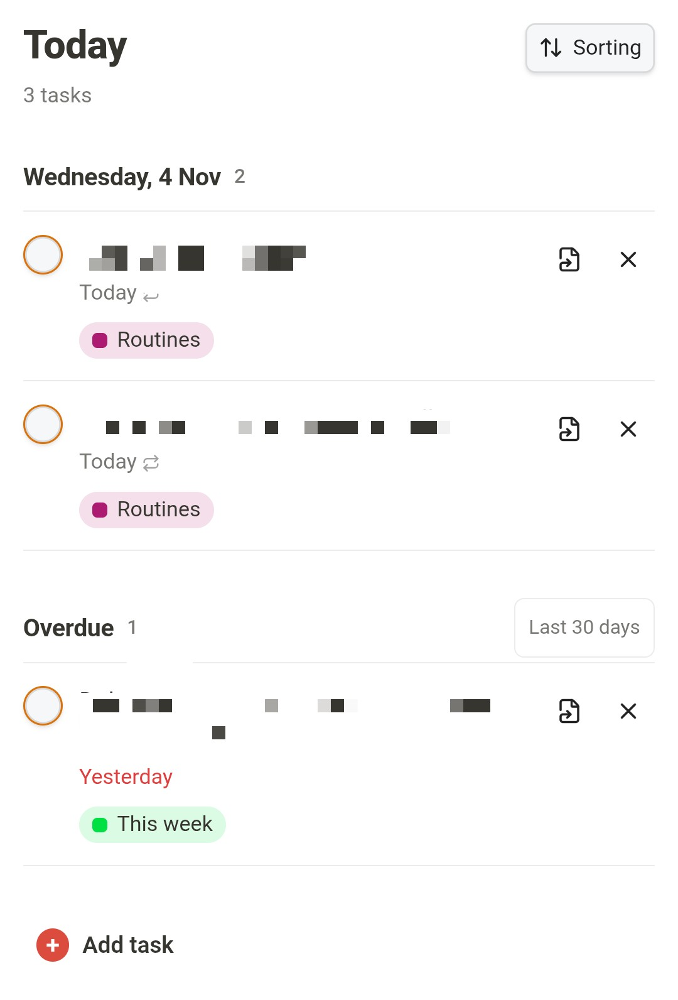
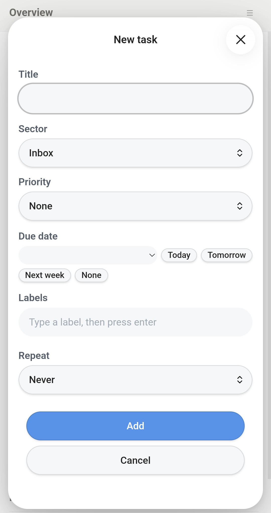
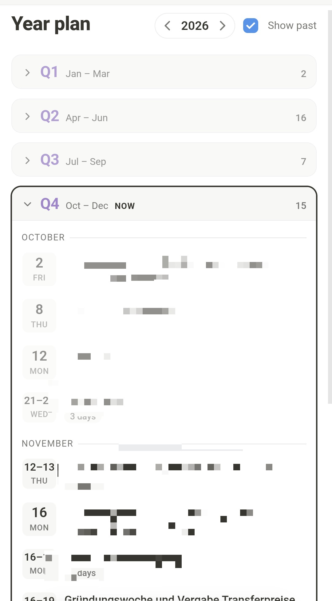

# Sector Tasks

A task board and year planner for Obsidian that keeps everything in **one Markdown file** — plain, readable lines you can edit by hand. Tasks are grouped by **when** you'll do them, using configurable sector tags: designed for [Carl Pullein](https://www.carlpullein.com/)'s Time Sector System, usable with any tag scheme.

- **Board** with Overview, Inbox, Today, Upcoming and your sectors; quick capture, snooze, drag and drop, search
- **Guided reviews** — daily, weekly, monthly — that walk you through each sector, with an optional summary note
- **Year plan**: appointments and milestones by quarter, right in the same file, and alongside your tasks
- **Its own editor** for title, sector, priority, due date, labels and repeat; no other plugin needed
- The file uses the emoji syntax of the [Tasks plugin](https://publish.obsidian.md/tasks/Introduction) (`📅`, `⏫`, `🔁`, …), so it stays compatible if you also use Tasks — but Tasks isn't required

*Overview.*

## The Time Sector System

The default sector setup implements the [Time Sector System](https://www.carlpullein.com/blog/a-revolutionary-new-time-management-system-designed-for-the-21st-century/1/5/2020) by productivity coach [Carl Pullein](https://www.carlpullein.com/). Its core idea: instead of organizing tasks by project, you organize them by **when** you will do them — this week, next week, this month, next month, or long term. Processing a new task then requires only one decision: When will you do it? Daily, weekly and monthly planning sessions move tasks up between sectors; routines and waiting-for items live in their own sectors. The system builds on Pullein's **COD workflow** (Collect, Organise, Do): capture everything quickly, organise by time sector, then focus on doing this week's list. Pullein explains it in depth on [his YouTube channel](https://www.youtube.com/@Carl_Pullein).

However, this plugin doesn't enforce any of that: sectors are just configurable tags, and you can name, order, and review them however you like.

## Why
Many task plugins manage their own data format. Sector Tasks keeps everything as plain, readable lines in one Markdown file, in the widely used Tasks emoji syntax (`📅`, `⏫`, `🔁`, …) — so the file stays a single source of truth you can read, edit, and search like any other note, with or without the plugin.

## Features

### Overview
- An **Overview** dashboard in the sidebar: two progress rings (Today, plus whichever sector tab is selected), Overdue / Done today / Done this week counters, a sector tab bar (Inbox first, then your sectors), and a quick-add + compact task list scoped to the selected tab
- **Focus in Today (2+8)** (optional, off by default): following Carl Pullein's 2+8 method, Today opens with **Must do** (your priority 1 tasks, up to 2) and **Next** (priority 2, up to 8), from any sector and whatever their date; the count turns red past the limit, and these tasks aren't repeated in the date sections below. Pick them in the evening with right-click → priority. Settings → Focus in today (2+8)
- **Start view:** choose which view the board opens on — Overview, Today, Inbox, or Upcoming (Settings → Start view; default Today)

### Board & sectors
- Board view grouped by sectors (default: `#01this-week` → `#02next-week` → `#03this-month` → `#04next-month` → `#05longterm` → `#routines` → `#waiting`), plus an **Inbox** for tasks without a sector tag
- **Combine sectors:** Ctrl/Cmd+click a sector in the sidebar to view several sectors together (e.g. This Week + Next Week); a plain click still shows just one
- Sectors are fully configurable: tag text, display name, order, and count can all be adjusted, including automatic migration of already-tagged tasks when renaming; one sector can be marked **Waiting for** (its own review handling instead of the sector logic). They live on their own **Sectors** settings page (a collapsible group on Obsidian before 1.13), and renaming a tag or removing a sector first asks for confirmation and tells you how many tasks are affected
- Multi-select (Ctrl/Cmd+click) with shared drag-and-drop (sector, due date, Inbox); right-click the selection to set the due date, snooze or priority for all of them at once
- Sort modes: smart, due date, priority, deadline, created, project
- Full-text search across all tasks; the **Open search** command jumps straight to it — assign a hotkey under Obsidian's Settings → Hotkeys — and an optional setting excludes completed tasks from results
- Jump button per task: opens the underlying note at the matching `🆔` line

### Capturing & editing
- **Own task editor:** "+ Add task" and clicking a task open a dialog with title, sector, priority, due date (with Today / Tomorrow / Next week shortcuts), labels (with suggestions from the ones you already use) and repeat (every day / weekday / week on a weekday / month on a day / year, every N, optionally counted from completion). `Cmd/Ctrl+Enter` saves. A free-text recurrence written earlier, like `every 15 july`, is kept exactly as written unless you change the repeat settings
- Only lines tagged `#task` are managed; everything else in the file is left untouched; additional `#tags` on the line are preserved
- **Quick capture:** the Inbox (and the Overview's Inbox tab) has a text field — type a task and press Enter, no modal. Paste a list (from a note or an email) and each line becomes its own task; list markers like `-`, `*` or `1.` are dropped. Inline `#labels`, a `#sector` tag, priority emojis and `📅 2026-11-10` are recognized like in a normal line
- **Quick add task (Inbox)** command: opens the editor and files the new task straight into the Inbox — assign it a hotkey under Obsidian's Settings → Hotkeys to capture tasks without opening the board
- **Right-click quick edit:** right-click any task row (board or Today sidebar) to set the due date (Today / Tomorrow / Next week / clear), **snooze** it by 1, 3 or 7 days (the menu shows the resulting date; it counts from the due date if that's still ahead, otherwise from today), or set the priority (P1–P4 / none), without opening the editor
- **Undo:** checking a task off shows a short notice with an **Undo** link that restores the exact previous state — including recurring tasks that were rescheduled. Also available as the **Undo last completed task** command for a hotkey

### Year plan
- **Planning entries** are ordinary lines in your tasks file tagged `#planning` — appointments, deadlines, events. Add `#milestone` for milestones. A multi-day entry uses the Tasks start date: `- [ ] Senat und Hauptausschuss #task #planning 🛫 2026-09-16 📅 2026-09-17`
- **Month or quarter only:** when there's no exact day yet, use `#planning/month` or `#planning/quarter` (the editor and the year plan's **+ Add** offer "Sometime in April" / "Sometime in Q2"); the 📅 date is the period's first day. These show at the top of their month or quarter, count as past only once the period is over, and stay out of the day-based strips on Today and Upcoming
- They never show up as tasks: not in the Inbox, sectors, reviews, search or counts. The plugin files new ones under a `## Planning` heading at the end of the tasks file, sorted by date
- **Year plan** view: the four quarters as columns, months inside, the current quarter highlighted; past entries turn grey. Click a quarter's header to fold it; past quarters start folded, the current and upcoming ones open. **+ Add** in a quarter creates an entry without a dialog; click an entry to edit it, jump to its line, or delete it
- Appointments aren't checked off. Milestones are ("Mark as reached"); one still open after its date shows **Not reached**
- **Today** and **Upcoming** show a small Planning strip above your tasks (today plus the next 7 days / next 2 weeks), the **Overview** lists the next events, the **Today sidebar** shows today's and tomorrow's, and the **Monthly Review** opens with what's coming up in the next two months
- **Turn it off** under Settings → Year plan if you don't use it: the view, the strips and the Overview list disappear, and any `#planning` lines stay in the file untouched
- **Past years** move to the archive note on startup once they're over (Settings → Archive past years' planning, on by default), so the tasks file only holds this year and the years ahead. The year plan still shows archived years, read-only

### Reviews
- Each sector can be independently included in **Weekly** and/or **Monthly Review** — no fixed positional assumption about which sectors belong where
- **Weekly/Monthly Review**: a guided, sector-by-sector walkthrough (Inbox → configured sectors → Waiting), with Stay/Up/Down/Inbox per task, or Follow up/Keep waiting for Waiting-tagged tasks; progress persists across interruptions
- **Waiting age:** tasks in the Waiting sector show how long they've been waiting ("Waiting 12 d"), on the board and in the review. After a configurable number of days (Settings → Sectors, default 7) the count turns red as a nudge to follow up. The date is kept in the plugin's data, not in your tasks file
- **Stuck tasks:** a task that sits 3 weeks (configurable under Settings → Sectors, 0 turns it off) in the same sector gets a note: "3 weeks in This week" on its weekly-review card, a small "3 wk" on the board, and a "Stuck" list in the review summary note. Only sectors in the weekly review count, recurring tasks never do, and moving a task restarts the count. The dates are kept in the plugin's data, not in your tasks file
- **Review summary note** (optional, off by default): after a Weekly or Monthly Review, a note like `Reviews/Weekly review 2026-W45.md` lists what you finished recently, what moved or was deleted during the review, what's new, the waiting list with ages, and open/overdue counts per sector
- **Daily Review**: a shorter, date-based walkthrough (Inbox → due today → due tomorrow or overdue), with Reschedule/Next per task instead of sector logic
- **PROCESS button** in the Inbox: runs the review workflow for the Inbox only
- **Review reminders:** the Weekly and Monthly Review buttons show a dot as long as no review of that kind has been completed in the current ISO week / calendar month
- **Review hotkeys** (desktop): `K` move up, `J` move down, `I` to Inbox, `N` next/leave unchanged, `F` follow up, `W` keep waiting, `R` reschedule, `D` done, `X` delete (press twice to confirm). In the Inbox step, `1`–`9` assign the task directly to the corresponding sector (order as configured in settings; the current mapping is shown inside the review). On mobile, the Inbox step shows one button per sector instead.

### Today sidebar
- The **Open Today sidebar** command opens a compact panel in the right sidebar with overdue, due-today, and due-tomorrow tasks — check them off or click to edit next to whatever note you're working in
- The tab shows a badge with the count of overdue + due-today tasks; header buttons quick-add to the Inbox and jump to the full board

### Housekeeping & appearance
- **Release notes after updates:** the first time Obsidian starts after the plugin updated, a short "What's new" dialog lists the changes since the version you last saw (skipped versions included). It never appears on a fresh install, can be turned off in the settings, and the **Show release notes** command opens it any time
- **Auto-cleanup:** optionally delete completed tasks from the file N days after completion (settings, default off); removed tasks are archived to a sibling `… (archive).md` note first, and deletion is skipped if that archive write fails. The **Clean up completed tasks now** command runs it on demand and reports what happened
- **Path warning:** the settings show a note when the configured Tasks file path points to a folder or a file that doesn't exist yet
- **Completed stats:** the Completed view shows how many tasks you finished today and this week
- **Task rows:** choose **Stacked** (title with due date/labels below) or **Single line** (everything on one row, for a much shorter list) under Appearance → Layout
- **Style:** choose **Default** or **Editorial** under Appearance → Theme. Editorial uses serif headings, sections as cards with a header tinted in the sector's color, pill-shaped dates and labels, and tiles for the Overview's rings and counters. Its warm palette applies when the color scheme follows Obsidian
- **Theme**: follow the active Obsidian theme, use a fixed light/dark palette, or customize every color individually; all cosmetic options live in a collapsible **Appearance** settings group

## Screenshots
### Desktop version

### Mobile

## Requirements
Nothing besides Obsidian. The Tasks plugin is no longer needed since 1.5.0 (you can keep it installed; the file format is the same). Tasks are kept in a single file.

## Installation

See [INSTALL.md](./INSTALL.md) for step-by-step setup, the field-mapping table, and notes on recurrence rules.

## Not supported (by design)

Descriptions, attachments, sub-tasks and deadlines. A task is one line: title, sector, labels, priority, due date and repeat. Anything longer belongs in a note you link from the title (`[[…]]`). Dates the board doesn't use (`⏳` scheduled, `❌` cancelled) and the `[/]`/`[-]` states are kept as they are when a line is rewritten.

## Status

The current version is the latest [release](https://github.com/leotomhal/sector-tasks-obsidian/releases) (also in [manifest.json](./manifest.json)). Full history in the [changelog](./CHANGELOG.md); ideas not yet built are in the [roadmap](./ROADMAP.md).

## Development transparency

This plugin was developed in close collaboration with an AI assistant (Claude). All code is AI-generated; direction, feature decisions, testing, and bug reports are human. Review the code before trusting it with your notes — as you should with any plugin. The task-line parsing/serialization (the part that writes to your file) is covered by an automated test suite (`npm test` / `node --test`).

## License

MIT, see [LICENSE](./LICENSE). The board started from [belki](https://github.com/aribuga/obsidian-belki-tasks) by Yasin Aribuga (also MIT).

## Contact

Questions, bug reports, or feedback: [tom@beyondthevault.de](mailto:tom@beyondthevault.de)
